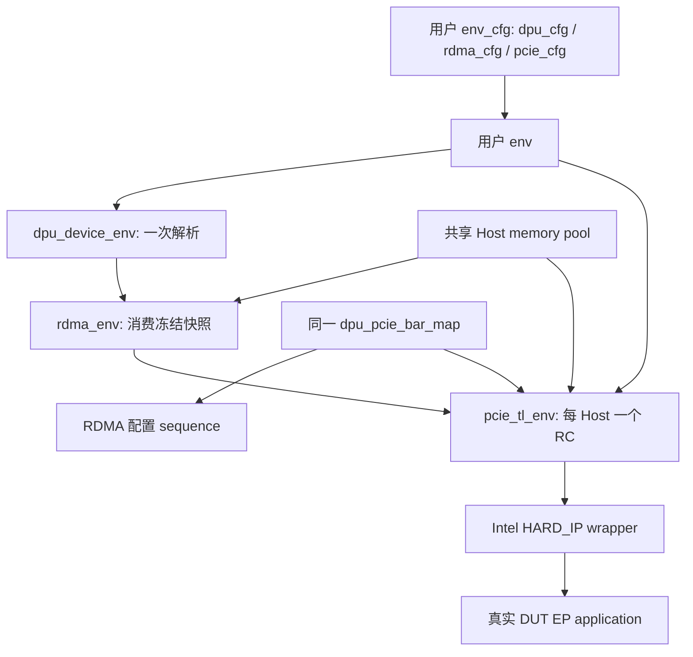

# RDMA + DPU + Intel PCIe 集成参考

这是按 Virtio 当前 [integration/project](../../virtio_work/integration/project/README.md) 方式整理的**设计案例**，不是本分支已经可运行的 DUT test。公共 API 的调用片段来自当前依赖源码；拟新增的 RDMA/project 接口会单独注明。完整职责与改动范围见 [设计文档](superpowers/specs/2026-11-09-rdma-intel-project-integration-design.md)。

## 1. 用户工程的最小组成

建议参考入口放在以下位置；这些源码文件尚未创建，避免把设计片段误加入生产编译：

```text
integration/project/
    rdma_project_cfg.sv       # 用户 cfg 的组合示例
    rdma_project_env.sv       # 创建、绑定、发布句柄与 AIP 入口
    project_dut_cfg_seq.sv    # 一个主 seq 编排公共配置及 RDMA/VIO
    rdma_project_test.sv      # 平台 hooks 与启动顺序
    rdma_project_pkg.sv       # 上述文件的唯一 include 入口
    README.md
sim/filelists/
    project_integration.f    # 可选参考工程入口
```

现有 `src/adapters/dpu`、`host_mem`、`pcie_work` 和 `aip` 负责改造自己的能力，不再新建另一套同名 BAR registry、公共配置对象或 task 管理器。参考 cfg/env 使用 `rdma_project_*` 命名；混合工程只保留一个 `project_dut_cfg_seq` 入口，用户可直接合入自己的 env/cfg。



## 2. cfg 直接组合；authoring 只做一次

放在用户 cfg 类中的字段片段如下；构造函数创建三份配置即可。无需继承参考 cfg。

```systemverilog
// 用户 cfg 拥有三份子配置；pool 由用户环境拥有，配置只借用。
dpu_env_cfg				dpu_cfg;
rdma_env_cfg				rdma_cfg;
pcie_tl_env_config		pcie_cfg;
host_mem_pool			shared_pool;
int unsigned			tl_slot_by_host[int unsigned];
```

平台在 DPU resolve 前使用公共 authoring 类型声明 Host、Function、RDMA service 和资源需求，并提供 `function_policies` 的真实 requester/Intel PF/VF，以及适用表的布局和内容。DPU 是最终资源的唯一权威。

当前 `dpu_env_cfg.load_params()` 默认创建 VIO 输入，不能把它当作 RDMA 自动配置，也不能在平台已经构造非空拓扑后再调用。这里选择**平台提供已完成 authoring 的 dpu_cfg**；RDMA 只加载自己的业务参数。`dpu_device_env` 随后进行一次解析。

首个具体场景采用 Host0 的管理 PF0 加一个平台支持的 RDMA VF：PF0 承担 AF/管理 BAR 访问，VF 的 Notify owner、8-bit RDMA ID 和实际 doorbell 地址由平台提供，表行号按驱动的查找 key 排序生成。混合场景再给另一实际 Function 声明 VIO service，两者共享同一 DPU 配置与 Host 内存。该场景不把 `global_id`、PCIe VF index 或 Notify 行号当作 RDMA ID，也不填入猜测的 BDF/BAR 数值。

## 3. 创建组件与绑定共享内存

以下是用户 env `build_phase` 中可复用的公共 API 片段。前置条件是三份 cfg、Host→slot 映射和 Intel VIF 已检查；`host_count` 来自 DPU authoring 的 Host 数量，不从 RDMA 再生成一份拓扑。

```systemverilog
cfg.pcie_cfg.rc_agent_enable = 1;
cfg.pcie_cfg.rc_is_active    = UVM_ACTIVE;
cfg.pcie_cfg.num_rc          = host_count;
cfg.pcie_cfg.ep_agent_enable = 0;
cfg.pcie_cfg.num_ep          = 0;
cfg.pcie_cfg.ep_auto_response = 0;
cfg.pcie_cfg.use_unified_mem = 1;
cfg.pcie_cfg.mem_access_mode = PCIE_TL_MEM_PER_BUFFER;

uvm_config_db#(dpu_env_cfg)::set(this, "dpu_env", "cfg", cfg.dpu_cfg);
uvm_config_db#(dpu_env_cfg)::set(this, "pcie_env.*", "dpu_cfg", cfg.dpu_cfg);
dpu_env = dpu_device_env::type_id::create("dpu_env", this);

intel_pcie_configure_env(this, cfg.pcie_cfg, "pcie_env");
// 在 create 前安装改造后的 RDMA RC driver 实例 override，不能全局覆盖全部 RC。
pcie_env = pcie_tl_env::type_id::create("pcie_env", this);
```

真实 RC driver override 与 RDMA 子环境创建依赖尚待实现的外部绑定路径，上面没有把当前 `rdma_env` 当作已支持该路径。当前 `rdma_env_cfg.finalize()` 仍拒绝 DUT Function；不能只移除该检查而保留 `node.dev.nic` 等模型依赖。

共享内存绑定使用下列现有接口，必须在 PCIe 子组件 build 前完成。`manager` 是平台 pool 中属于 `host` 的唯一 manager；其 Host 身份、GPA 范围、分配策略必须与 DPU 一致，`slot` 由完整映射得到：

```systemverilog
if (!cfg.pcie_cfg.bind_host_memory(slot, host, manager, why)) begin
	`uvm_fatal("RDMA_PROJECT", why)
end

// 每个 Function 新建一个记账视图，背后的 manager 与 PCIe 相同。
function_mem = rdma_host_mem::type_id::create(function_name);
function_mem.mem = manager;
```

集成路径不能继续调用会自动创建固定地址 manager 的 `rdma_host_mems.make()`。现有 `rdma_host_mem` 的分配/访问账本可复用；PCIe DMA 接收还须按 requester 找到对应 Function 并执行这一隔离检查，不能仅凭共享 manager 地址有效就允许访问。

## 4. connect 阶段发布同一 BAR/Intel map

下面是组装函数内的调用片段，不是独立编译单元。组装前需要检查：快照非空，Host→slot 完整且一一对应，slot 在 RC 数组内，每个 RC sequencer 非空。`map` 的所有权属于用户 env，DPU cfg/RC/配置 sequence 借用它。

```systemverilog
dpu_pcie_bar_map		map;
dpu_function_key_t	keys[$];
dpu_function_policy_t	policy;
string				why;
string				name;

map = dpu_pcie_bar_map::type_id::create("bar_map");
if (!map.initialize(dpu_env.get_snapshot(), 1, why)) begin
	`uvm_fatal("RDMA_PROJECT", why)
end

foreach (cfg.tl_slot_by_host[host]) begin
	int unsigned	slot;

	slot = cfg.tl_slot_by_host[host];
	if (!map.bind_host(host, slot, why)) begin
		`uvm_fatal("RDMA_PROJECT", why)
	end
	map.rc_sequencers[slot] = pcie_env.rc_agents[slot].sequencer;
end

dpu_env.get_snapshot().list_functions(keys);
foreach (keys[i]) begin
	name = dpu_function_key_name(keys[i]);
	if (!cfg.dpu_cfg.function_policies.exists(name)) begin
		`uvm_fatal("RDMA_PROJECT", {"missing Intel policy: ", name})
	end
	policy = cfg.dpu_cfg.function_policies[name];
	if (dpu_function_key_name(policy.key) != name || $isunknown(policy.requester)) begin
		`uvm_fatal("RDMA_PROJECT", {"invalid Intel policy: ", name})
	end
	if (!map.bind_function(
		keys[i], policy.intel_pf, policy.intel_vf, policy.requester, why
	)) begin
		`uvm_fatal("RDMA_PROJECT", why)
	end
end

if (!map.freeze(why)) begin
	`uvm_fatal("RDMA_PROJECT", why)
end
if (!cfg.dpu_cfg.publish(
	dpu_env.get_snapshot(), dpu_env.get_resource_snapshot(), map, why
)) begin
	`uvm_fatal("RDMA_PROJECT", why)
end
```

随后把**同一个 map** 和当前 Host/segment/slot 注入改造后的 RDMA RC driver。这个注入接口尚待实现；不能直接调用 Virtio 的 `install_receive_path()`，因为它包含 VIO 的 IOMMU/MSI-X 语义。

参考 [公共 map](../../dpu_common/integration/pcie/dpu_pcie_bar_map.sv) 的 `route_memory()`、`route_completion()`、`resolve_requester()`，补充 Function 内存所有权与 epoch 检查。发送仍调用 PCIe 父类，保留 tags、严格顺序和 Completion 错误处理。

## 5. Intel wrapper 与平台 hooks

复用 [Intel wrapper](../../pcie_intel/bind/intel_pcie_bind_wrapper.sv) 的 `intel_pcie_bind_wrapper_inout`：`SIDE="HARD_IP"`，`ADAPTER_PATH` 指向实际 RC adapter，例如 `uvm_test_top.env.pcie_env.rc_adapter_0`。它按该路径发布 `vif` 和 `intel_cfg`。

每个 Host 连接自己的真实 Intel AVST 接口，wrapper 几何参数和本地 credit 配置与 RTL 一致。公共 TL 无限 credit 不替代 Intel 本地信用。不同端口不共享同一可变配置/VIF。时间 0 先完成发布，再由唯一 top 调用 `run_test`，必要时使用 `#0` 排定顺序。

参考 base_test 的三个平台接口如下；这是拟新增类的声明片段，具体实现由平台提供：

```systemverilog
// 功能：将平台已创建的 Intel/网络接口和共享 pool 绑定到项目配置。
// 输入输出及副作用：使用派生 test 的平台句柄；不重新解析拓扑或取得对象所有权。
// 失败边界：缺失必需接口、Host/slot 错配或跨端口复用时拒绝构建。
pure virtual function void bind_platform_handles();

// 功能：执行平台复位并等待 Intel 接口及外部 endpoint 就绪。
// 输入输出及副作用：可能驱动 reset；正常返回表示允许开始 DUT 配置。
// 失败边界：必须有平台超时；就绪失败或任务被取消时不能继续配置。
pure virtual task prepare_platform();

// 功能：排空业务，检查数据、DMA 和 PCIe/网络结果，并确认 DUT 停止访问资源。
// 输入输出及副作用：消费平台检查结果；确认静止后才允许释放 RDMA 当前代资源。
// 失败边界：未排空、数据错误或停机超时必须报告失败，Tcl 返回不代表检查通过。
pure virtual task finish_platform();
```

## 6. 复用 DPU 配置步骤

拟新增的 `project_dut_cfg_seq` 派生 `dpu_cfg_seq`。下面先展示 RDMA-only 配置片段，`public_scope` 和 `rdma_scope` 来自已验证的真实 Function 选择，`cfg` 由父类 `pre_start()` 从 RC sequencer 的 `dpu_cfg` 获取。RDMA scope 使用非空 Function 集合及表类别，RDMA service 另外在快照中验证；当前公共 scope 的显式 service 校验只支持 VIO。

```systemverilog
declare_af(ok, error_msg);
if (!completed_step("declare_af", ok)) return;

configure_bdf_table(public_scope, ok, error_msg);
if (!completed_step("configure_bdf_table", ok)) return;

configure_rdma_notify(rdma_scope, ok, error_msg);
if (!completed_step("configure_rdma_notify", ok)) return;

configure_qsch_rnet(rdma_scope, ok, error_msg);
if (!completed_step("configure_qsch_rnet", ok)) return;
```

这不是完整 RDMA 初始化 body。平台选用的 MSI-X/公共表、CMQ probe、CQ/QP/MR 准备仍须按真实资源依赖插入；只有所有必需步骤成功才能设置 `success=1`。父类默认 body 是 VIO 流程，不能用 `super.body()` 替代 RDMA 组装。

公共 Notify 方法会从 `frozen_controls` 取显式记录，先完整验证范围，再写表；全部成功后才写管理 BAR 的 `+0x80044=1`。缺少实际 RDMA 记录不能因“零条写成功”而将业务标为就绪；project 预检必须覆盖被选择的 RDMA 服务。

保留父类失败 fatal 的 `post_start()`。如果将来改成 Tcl 可恢复错误，需要同步显式返回 AIP 非零状态；仅保留 `success=0` 不足以让 `aip_cmd_user_seq` 自动识别失败。

## 7. 参数读取与 AIP 注册案例

参数宏可以直接复用。以下片段放在加载器中，`cfg` 为现有 `rdma_env_cfg`，局部同名变量保持外部路径 `rdma.env.qp_depth`：

```systemverilog
int unsigned	qp_depth;

`aip_int("rdma.env", int unsigned, qp_depth, cfg.qp_depth)
// 在局部候选中完成范围/相互约束校验，再提交；不能边读边修改活动资源。
```

长度/SGE 等表达式使用字符串保存，生成每条 WR 时由 AIP 解释一次；重载、日志和队列满重试不能额外采样。同一参数不在 project、RDMA cfg、driver 各读一遍。

以下宏签名来自 `aip_core_set_param_expr` 当前版本。`project_dut_cfg_seq` 和 `project_rdma_load_params` 是本设计拟新增的入口；`project_rc_sqr` 是项目发布的非拥有 sequencer 引用，必须在进入 Tcl 前绑定。

```systemverilog
`aip_cmd_task(rdma_load_params, project_rdma_load_params)
`aip_cmd_user_seq(dut_config, project_dut_cfg_seq, project_rc_sqr)
`aip_cmd_reg(reg_acc, dpu_bar_reg_seq, project_rc_sqr, seq.error_msg, seq.check_read_data)
```

宏只编译/注册一次。既有工程已注册 `reg_acc` 时沿用原入口；不能为了 RDMA 再注册同名命令。使用项目已有 virtual sequencer 时，可以把 `project_rc_sqr` 替换成其已发布的 RC 引用。

下面是无参 task 的**拟实现契约示例**，其中 `project_runtime_env.load_params(ok, why)` 尚不存在，需要按设计中的候选验证/提交语义实现。它只为 AIP 入口保留一个环境引用，driver/router 不依赖这个引用。

```systemverilog
// 功能：把 AIP 当前参数重载到空闲的 RDMA 配置，不重新分配全局资源或写 DUT。
// 输入输出及副作用：从同名 command 获取 args_in，调用环境重载并发布 status/result_out。
// 失败边界：命令未注册时 fatal；带参数、环境未绑定、资源活动或候选非法时返回错误。
task project_rdma_load_params();
	aip_cmd	command;
	bit		ok;
	string	why;

	command = aip_cmd::get_handle("rdma_load_params");
	if (command == null) begin
		`uvm_fatal("RDMA_PROJECT", "rdma_load_params is not registered")
		return;
	end
	if (command.args_in != "" || project_runtime_env == null) begin
		command.status = 1;
		command.result_out = command.args_in != ""
			? "ERROR: rdma_load_params takes no arguments"
			: "ERROR: RDMA environment is not ready";
		return;
	end

	project_runtime_env.load_params(ok, why);
	command.status     = ok ? 0 : 1;
	command.result_out = ok ? "OK: RDMA parameters reloaded" : {"ERROR: ", why};
endtask
```

完成上述实现后，平台就绪且尚未创建当前代 RDMA 队列的 Tcl 场景可按以下命令约定执行。当前分支尚未注册这些项目命令：

```tcl
set_param path=rdma.env.qp_depth value=256
rdma_load_params
dut_config
reg_acc read 0x1010 check_read_data=0
# 随后启动项目注册的 RDMA 业务 sequence，并在 finish_platform 检查真实完成。
```

`dpu_bar_reg_seq` 当前针对 Host0/PF0 BAR0，`addr` 为 BAR 内字节偏移。`check_read_data=0` 只关闭 PCIe scoreboard 的历史 RAM 值比较，仍检查 Completion；这里读取 AF 状态还需要调用者判断其值是否为 8。其他 Function/BAR 用公共配置 sequence 的 `pcie_bar_write_by_name()` 等命名访问方法。

资源活动期间 `rdma_load_params` 返回错误；需要先由平台停止业务/DMA、释放当前代，再重载。恢复快照也不自动重采样，不允许借重载改变冻结的 Host/BDF/BAR 或重新绑定外部对象。

## 8. 编译与验证边界

包依赖顺序如下；这是顺序约束，尚未创建对应的新 filelist：

```text
UVM / AIP
  → host_mem / DPU resource / PCIe TL / net_packet
  → RDMA types/model/driver/env 及必要适配器
  → RDMA AIP
  → Intel interface/adapter
  → dpu_common/filelists/dpu_pcie.f
  → 改造后的 RDMA PCIe 适配器 / 混合工程所需的 virtio_dpu_pkg
  → 用户 env package 或 rdma_project_pkg
```

RDMA PCIe adapter 引入公共 map 后必须排在 `dpu_pcie_pkg` 之后。普通 `.sv` 被 package include 时不能再单独编译；生产核心 filelist 不自动引入 project 示例。AIP 使用 `aip_core_set_param_expr`，不要同时编译旧 `aip_core` package；Host manager/pool 使用 `host_mem_pkg` 中的类型。

软件侧需在 `ubuntu@10.11.10.53` 的 VCS 环境验证共享资源、双 Host/双实例路由、错误拒绝、AIP 结果、配置顺序和原有模型回归。实际 DUT 引脚、复位、Intel 交互、DMA/网络数据和恢复结果由平台接入后验证。

本案例目前完成接口核对与文档静态检查，未编译这些片段，也未声称 DUT 集成已经通过。

## 9. 已核对的 53 驱动来源

2026-11-09 实际登录 `ubuntu@10.11.10.53` 进行只读核对，未运行仿真，也未修改远端文件：

| 来源 | 位置与结论 |
| --- | --- |
| RDMA 内核驱动 | `/home/ubuntu/rdma_driver_analysis/kernel/dpu_kernel_rdma-version_0.1.34` |
| 对应原始归档 | `/home/ubuntu/Downloads/dpu_kernel_rdma-version_0.1.34.tar(1).gz`；SHA-256 为 `c9d9286dde389f681f9bd1c29fff14f52c4c1ce11fa5f73a5f1f57da9f827522`，与本仓库 `hw/rdma/archive_lock.env` 一致 |
| 真正的 AF Notify 写表代码 | `/home/ubuntu/Downloads/emp.zip` 内的 `emp/app/dpu/af_mng.c`；不是 RDMA verbs 的 `post_send()` |
| EMP 文件身份 | `af_mng.c` 的 SHA-256 为 `b28aec75f7a05c9f44ae3f7be18334418bb5f2717403645ee84be18385e32c6b` |

可直接作为算法依据的函数是：

- `af_mng.c:1171`，`dpu_get_rdma_notify_tbl_entry_key()`：取表项低 51 位。
- `af_mng.c:1180`，`dpu_af_insert_rdma_notify_tbl_entry()`：输入地址已经右移 13 位，按 `{host_id[2:0], address[60:13]}` 升序插入；填入 8 位 `rdma_vf_id`，通过 `wr32_for_high_order()` 写 8B 表项。
- `af_mng.c:1338`，`dpu_af_alloc_rdma_vf_id()`：从 256 项 RDMA bitmap 分配 ID，不取 global Function ID。
- `af_mng.c:1358` 的注释及 `:1363` 的 `dpu_af_configure_rdma_vf()`：名称中的 VF 实际指 PCI Function；依次配置 Notify、RDMA QSCH/RNET 以及相关 MSI-X。

生成当前表项时，先验证实际 Notify 窗口的 8KiB 对齐、地址可编码范围、Host 和 RDMA ID 位宽，再组装：

```text
entry[63:59] = 0
entry[58:51] = rdma_function_id
entry[50:48] = host_id
entry[47:0]  = actual_notify_address[60:13]
sort_key    = entry[50:0]
```

表项行号是排序结果，不是 RDMA ID。重复查找 key、重复 RDMA ID、容量超过 256 必须在第一笔写前拒绝。实际 Notify 地址由冻结 BAR 租约加业务 Notify 窗口偏移得到，不直接把 BAR 基址当成 doorbell 地址。RDMA 内核头文件的窗口起点为 `0x2000`，仍需与本项目实际 driver 绑定一致。

驱动版本差异必须保留记录：

| 项目 | RDMA 0.1.34 附带头文件 | 53 上 EMP | 当前 Virtio/DPU 配置约定 |
| --- | --- | --- | --- |
| RDMA Notify 表相对 PCOMPLETER 偏移 | `0x10000` | `0xc000` | `0xc000`，参考管理 BAR 内绝对偏移 `0x8c000` |
| RDMA Notify ready/select | `PCOMPLETER+0x48` | `PCOMPLETER+0x48` | 两类 Notify 使用 `管理 BAR+0x80044=1` |
| bank/写入批次 | 头文件带 `sel` | 整表写、读回重试、双 bank 翻转 | 单 bank、有效项批次、失败停止 |
| owner 类型 | 字段名为 `pfvf_id` | RDMA ID 对应 PCI Function，可含 PF | 当前公共校验暂限 VF |

当前使能行为已有 [Virtio 设计记录](../../virtio_work/docs/superpowers/specs/2026-11-09-dpu-config-consolidation-design.md) 明确说明。采用驱动的字段来源、排序与资源身份规则，保留当前硬件布局和使能约定；不能因为找到旧源码就恢复旧 bank 或 `+0x48`。当前 VF-only 校验也不能据此宣称硬件仅支持 VF。

## 10. RDMA 与 VIO 由一个 seq 配置

一个 `project_dut_cfg_seq` 持有同一 `dpu_cfg`、公共 map 和执行结果。是否需要 VIO/RDMA 由已解析的服务清单决定；混合 cfg 直接多组合一份 `virtio_net_env_config`，不再套一层统一业务配置对象。

```text
统一预检：快照 / Function / RDMA ID / BAR / 表布局
  → AF + 公共 BDF/BAR/MSI-X（按需求并集配置一次）
  → VIO 准备实际 ring；读取已冻结的 RDMA Notify 映射
  → 各自生成 Notify 记录；主 seq 合批写入
  → 每个管理 BAR 一次 Notify 使能
  → VIO QSCH/VTX/VRX；RDMA QSCH/RNET 路由
  → RDMA probe 与实际 QP/CQ/MR 准备；其余必需配置与检查
  → 全部成功后确认 READY，允许业务启动
```

RDMA Notify/RNET 所需的是冻结 Function 身份、RDMA ID 与实际 BAR 窗口，在 connect 的 `publish()` 前形成显式记录。主 seq 必须先完成这些路由配置，再启动会发送 CMQ 的 probe。QP/CQ/MR 的后续配置和网络投影才使用创建后的资源结果。

VIO 生命周期复用当前 helper，不另抄 prepare/commit/release 实现：

```systemverilog
// 主 seq 内部片段：只借用 helper 的资源方法，所有 MMIO 仍由主 seq 发出。
vio = vio_dpu_cfg_seq::type_id::create("vio_lifecycle");
vio.cfg = cfg;
vio.set_sequencer(m_sequencer);
vio.prepare_vio_configuration(vio_scope, ok, error_msg);
if (!completed_step("prepare_vio", ok)) return;
```

当前 helper 会查找每个 DPU Host 的 `vio_env_h<H>`；混合工程需完整发布这些句柄，无 VIO 服务的 Host 不创建 ring。不能只发布部分 Host 后假设 helper 会自动跳过。

Notify 合批使用已存在的 API；下列片段位于主 seq 内，`has_vio/has_rdma` 从实际服务清单产生，scope 已完成校验。无服务时跳过生成，不能传一个空成员 scope 代表“空集合”。

```systemverilog
dpu_table_item_t	batch[$];
dpu_table_item_t	items[$];
dpu_table_kind_e	vio_kinds[$] = '{DPU_TABLE_NOTIFY};

if (has_vio) begin
	if (!cfg.queue_records(vio_scope, vio_kinds, items, error_msg)) return;
	foreach (items[i]) batch.push_back(items[i]);
end
if (has_rdma) begin
	if (!cfg.public_records(DPU_TABLE_RDMA_NOTIFY, rdma_scope, items, error_msg)) return;
	foreach (items[i]) batch.push_back(items[i]);
end

// 两类记录都成功生成后，统一预检、发送、按管理 BAR 去重使能。
write_records(batch, ok, error_msg);
if (!completed_step("configure_notify", ok)) return;
```

这样既保留两种格式，又只有一次批次提交；任一记录生成失败不会写出另一类 Notify，任一表写失败不会发送本批使能。其他类别也由主 seq 的公共方法执行，AF 写计数不会在两类业务间重新开始。

混合场景不能为同一个 RC 分别安装 VIO 和 RDMA driver override；一个接收入口按 Function/service 路由到正确的 DMA 检查，仍由 PCIe 唯一 responder 应答。首个案例使用不同 Function 承载两类业务；同一 Function 同时承载两类服务时，还需按实际地址分配和中断身份分派，不能仅靠 Requester ID 区分，当前案例不宣称已支持。

混合工程的 AIP 命令只保留 `dut_config`、一个协调重载 task 和已有 `reg_acc`。重载必须先确认两类资源都处于允许阶段，再验证全部候选后一次提交；不能先改好 VIO 再发现 RDMA 活动而返回失败。
